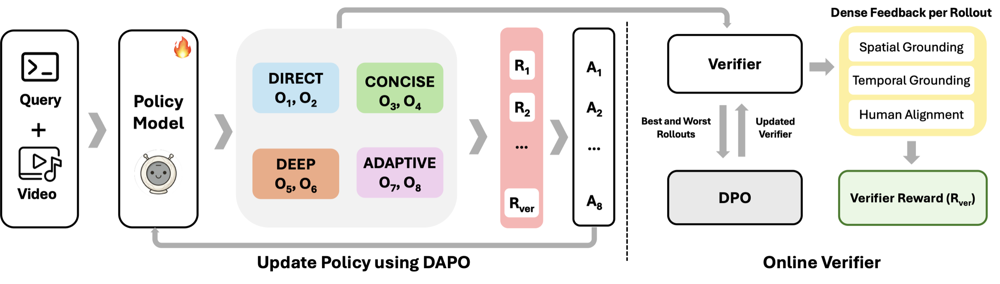

<h2 align="center"> <a href="https://arxiv.org/abs/2608.26495">Video-FLAIR: Not Whether to Reason, But How</a></h2>
<h3 align="center">NeurIPS 2026</h3>
<div align="center">

<br>

<a href='https://arxiv.org/abs/2608.26495'></a> &nbsp;
<a href='https://people-robots.github.io/Video-FLAIR/'></a> &nbsp;
<a href='https://huggingface.co/yogkul2000/Video-FLAIR'></a> &nbsp;
<a href='https://huggingface.co/datasets/yogkul2000/Video-FLAIR-data'></a>

</div>

## Abstract

Multimodal queries can require different types of reasoning. Some can be answered via perceptual reasoning, extracting information directly from the visual signal, while others require compositional reasoning that combines observations or deliberative reasoning that evaluates competing hypotheses. However, many existing methods apply a uniform reasoning strategy across queries, leading to unnecessary computation on simple tasks and insufficient reasoning on complex ones. We introduce Video-FLAIR, a training framework that learns to select the appropriate reasoning mode for each query using reinforcement learning. During training, the model generates responses under all three modes for the same prompt, enabling direct comparison. A composite reward compares these responses to favor the most effective one based on correctness, grounding, and cost, while discouraging unsupported or misaligned deliberation. This yields a supervision signal for learning adaptive reasoning without per-query annotations. Video-FLAIR improves accuracy over the Qwen2.5-VL base model by +5.4 on MathVista, +4.8 on Video-Holmes, and +4.8 on Video-MMMU, while reducing average token usage to 95 compared to 417 for always-thinking baselines.

<table class="center">
    <tr>
        <td align="center">
            
        </td>
    </tr>
    <tr>
        <td align="center"><em>Video-FLAIR training pipeline. Each video-query pair gets K=8 mode-structured rollouts (two each for DIRECT, CONCISE, DEEP, and ADAPTIVE). Reward components are normalized with GDPO and the policy is updated with DAPO. A verifier scores each rollout and is refreshed with DPO during training.</em></td>
    </tr>
</table>

## Release Status

- [x] Paper
- [x] SFT, difficulty filtering, GRPO, and verifier DPO training code on ms-swift
- [x] SFT traces and RL training data
- [x] Evaluation scripts

## Install

```bash
conda create -n flair python=3.13
conda activate flair

pip install torch==2.11.0 torchvision --index-url https://download.pytorch.org/whl/cu130
pip install vllm==0.23.0 transformers==5.12.1 trl==0.29.1 peft==0.20.0 accelerate==1.15.0 deepspeed==0.19.7
pip install qwen_vl_utils decord

cd ms-swift
pip install -e .
```

## Code Layout

All Video-FLAIR code lives in `ms-swift/examples/flair` and plugs into ms-swift through `--external_plugins`. No ms-swift source files are modified.

| path | contents |
|---|---|
| `flair/` | prompts, output parsing, answer scoring, rewards, verifier client, prioritized replay, GRPO trainer patch |
| `tools/` | data preparation, difficulty filter, verifier DPO pair builder, verifier refresher |
| `qwen2.5vl/` | launch scripts for Qwen2.5-VL |
| `qwen3vl/` | launch scripts for Qwen3-VL |

Every path is passed at runtime through arguments or environment variables. See [`ms-swift/examples/flair/README.md`](ms-swift/examples/flair/README.md) for the full list of options.

## Output Format

Each response is wrapped in a mode tag. The mode is either assigned in the system prompt or, in ADAPTIVE slots, chosen by the model. Word budgets for `<think>` are 60 (DIRECT), 200 (CONCISE), and 1000 (DEEP).

```
<DIRECT><think>...</think><answer>B</answer></DIRECT>
<CONCISE><think>...</think><answer>B</answer></CONCISE>
<DEEP><think>...</think><answer>B</answer></DEEP>
```

Reasoning can cite visual evidence with grounded spans `<obj>...</obj><box>[x1,y1,x2,y2]</box><t>seconds</t>`.

## Training

Run from `ms-swift`. Swap `qwen2.5vl` for `qwen3vl` to train Qwen3-VL.

```bash
cd ms-swift
S=examples/flair/qwen2.5vl

# 1. SFT warm start
python examples/flair/tools/prepare_sft.py --input $TRACES --media_root $MEDIA --output_dir $DATA/sft
MODEL=$BASE DATA_DIR=$DATA/sft OUTPUT_DIR=$OUT/sft bash $S/sft.sh
ADAPTER=$OUT/sft/<run>/checkpoint-N OUTPUT_DIR=$OUT/sft_merged bash $S/merge.sh

# 2. Difficulty filter (keep prompts the SFT policy solves 2 of 4 times)
python examples/flair/tools/prepare_rl.py --input $TRACES --media_root $MEDIA --output $DATA/rl/rl_all.jsonl
MODEL=$OUT/sft_merged RL_DATA=$DATA/rl/rl_all.jsonl OUTPUT_DIR=$OUT/difficulty bash $S/difficulty.sh

# 3. Verifier server and DPO refresher (can run on a separate machine)
CUDA_VISIBLE_DEVICES=0 VERIFIER_MODEL=$QWEN3VL_8B PORT=8100 bash $S/verifier_server.sh
CUDA_VISIBLE_DEVICES=1 VERIFIER_MODEL=$QWEN3VL_8B python examples/flair/tools/verifier_refresh.py \
    --pair_dir $SHARED/grpo_pairs --work_dir $OUT/verifier_dpo \
    --server_url http://127.0.0.1:8100/v1 --dpo_script $S/verifier_dpo.sh --every 100

# 4. GRPO
FLAIR_VERIFIER_URL=http://$VERIFIER_HOST:8100/v1 FLAIR_PAIR_DIR=$SHARED/grpo_pairs \
MODEL=$OUT/sft_merged DATASET=$OUT/difficulty/rl_train.jsonl OUTPUT_DIR=$OUT/grpo bash $S/grpo.sh
```

`$SHARED` must be visible to both the trainer and the verifier refresher. The verifier receives frames inline, so its machine does not need the media files.

## Rewards

| reward | role |
|---|---|
| `flair_ans` | answer correctness (multiple choice, numeric, open-ended, temporal IoU, boxes) |
| `flair_format` | well-formed mode tags, `<think>` and `<answer>` blocks |
| `flair_comply` | output uses the assigned mode and stays within its word budget |
| `flair_cost` | base cost plus adaptive length penalty scaled by group accuracy and a per-mode multiplier |
| `flair_balance` | mode diversity within a rollout group |
| `flair_select` | ADAPTIVE slots that pick the highest-utility mode for the query |
| `flair_verifier` | verifier score over the grounded reasoning spans |

Reward components are normalized per component (GDPO) and optimized with the DAPO loss. Advantages are reweighted at the token level using span credit from the verifier, and a prioritized replay buffer re-samples hard prompts with clipped importance weights.

## Evaluation

Evaluation code for the 11 benchmarks in the paper is in [`eval/`](eval). It runs on lmms-eval and takes the path to a downloaded checkpoint:

```bash
cd eval
bash setup.sh
bash run_eval.sh /path/to/downloaded/checkpoint results
```

See [`eval/README.md`](eval/README.md) for the task list and judge settings.

## Citation

If you find Video-FLAIR useful for your research, please cite our paper:

```bib
@inproceedings{kulkarni2026videoflair,
  title={Video-FLAIR: Not Whether to Reason, But How},
  author={Kulkarni, Yogesh and Fazli, Pooyan},
  booktitle={Advances in Neural Information Processing Systems (NeurIPS)},
  year={2026}
}
```

## Contact

For questions about the paper, please contact Yogesh Kulkarni at `ykulka10@asu.edu`. You can also open an issue in this repository for bugs or questions about the code.
